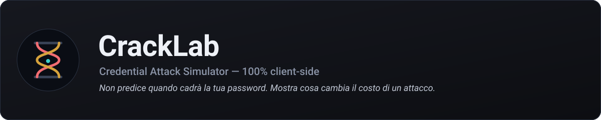
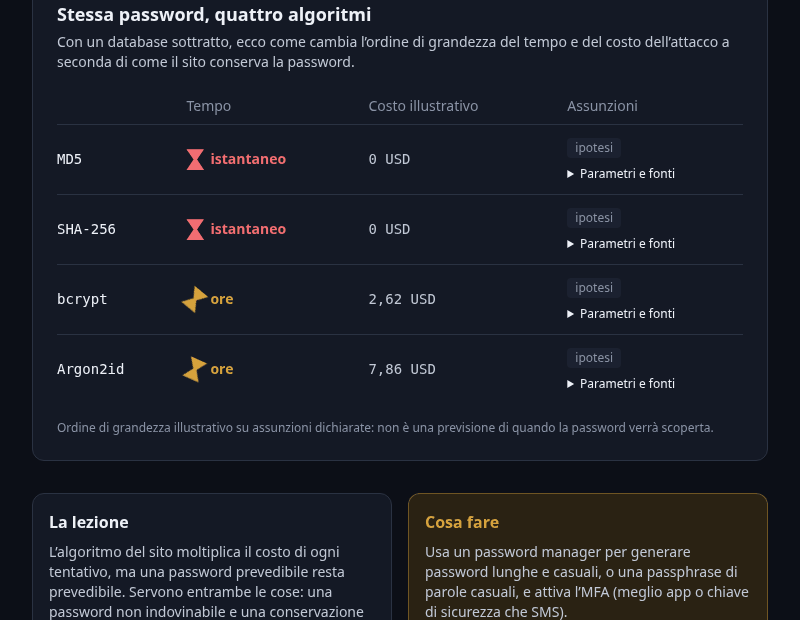
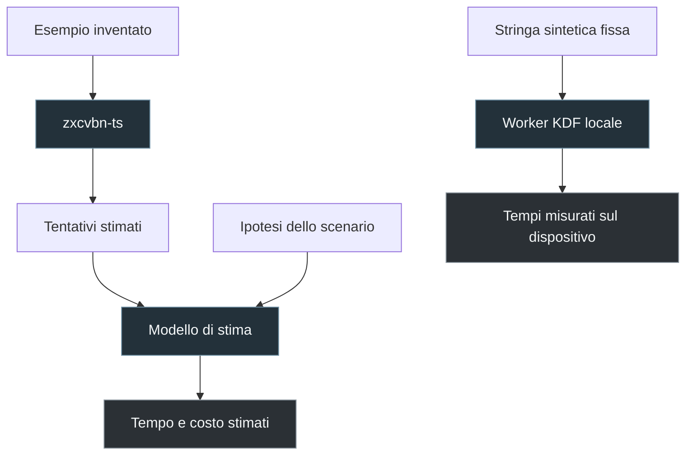

<p align="center"></p>

<p align="center"><a href="README.md">🇬🇧 English</a> · <a href="README.it.md">🇮🇹 Italiano</a></p>

<p align="center">
  
  
  
  
  
</p>

> Non predice quando cadrà la tua password. Ti mostra cosa cambia davvero il costo di un attacco.

<p align="center"><a href="https://cracklab-pi.vercel.app"><strong>Demo live</strong></a> · <a href="SECURITY.md">Sicurezza</a> · <a href="docs/PRIVACY.md">Privacy</a> · <a href="docs/MODEL.md">Modello di stima</a> · <a href="docs/THREAT_MODEL.md">Threat model</a> · <a href="LICENSE">Licenza</a></p>

---

## 🇮🇹 Italiano

## Panoramica

**CrackLab** è un simulatore educativo bilingue, **100% lato client**. Mostra _come_ funzionano gli attacchi alle
credenziali e _quanto_ le difese moderne ne aumentano il costo — senza essere un cracker. Ogni numero mostrato è un
**ordine di grandezza** su **assunzioni dichiarate**, non una previsione.

La lezione centrale: **l'algoritmo del sito moltiplica il costo di ogni tentativo, ma una password prevedibile resta
prevedibile.** Servono entrambe le cose: una password non indovinabile _e_ una conservazione corretta lato server.

Non è un cracker, per scelta architetturale: nessun input di hash di terzi, nessun wordlist-cracking, nessuna funzione
"buca questo hash". Ogni scenario d'attacco termina in una difesa concreta.

## Funzionalità (MVP — "Prova")

- **Tre esempi precaricati** con prevedibilità diversa, più una password di prova inventata da digitare.
- **Stima locale della prevedibilità** con [zxcvbn-ts](https://zxcvbn-ts.github.io/zxcvbn/) (tentativi stimati, punteggio 0–4).
- **Stessa password, quattro algoritmi** — MD5 / SHA-256 / bcrypt / Argon2id — confrontati per ordine di grandezza del
  tempo d'attacco e un costo illustrativo, con la provenienza di ogni numero (`misurato` / `derivato` / `ipotesi`).
- **Una lezione e un'azione concrete** (password manager, passphrase generata, MFA).
- Bilingue **IT/EN**, tastiera completa, `prefers-reduced-motion` e avviso permanente "usa un esempio" — fin dal primo giorno.

**Capisci** propone quattro esperimenti con previsione, difesa modificabile, quiz e scheda scaricabile. **Progetta** misura un input sintetico con parametri KDF regolabili ed esporta i risultati locali. Include anche un laboratorio di policy, un generatore di passphrase e una dimostrazione delle precomputazioni. La verifica facoltativa Pwned Passwords ha una pagina di consenso separata. Dopo la prima installazione online, i percorsi didattici funzionano offline.



[Salt e prevedibilità](docs/research/salt-e-prevedibilita.md) · [Dal primo fattore alla sessione](docs/research/dal-primo-fattore-alla-sessione.md) · [Clip del confronto](assets/media/confronto.mp4) · [Clip MFA](assets/media/secondo-fattore.mp4)

## 🗺️ Diagramma dell’architettura



La stima di robustezza usa l’esempio inserito nel browser. Il laboratorio dei tempi usa una stringa sintetica fissa e misura le prestazioni del dispositivo locale.

## Il modello di stima

Il modello è il cuore contestabile e trasparente del progetto. Per ogni _esempio × algoritmo × scenario_:

```
tentativi_stimati = guesses di zxcvbn (NON 2^entropia, NON l'intero spazio delle chiavi)
hashrate          = benchmark per algoritmo/parametri/hardware (data/benchmarks.json)
tempo_stimato     = tentativi_stimati / hashrate
costo_stimato     = (tempo in ore) × prezzo_orario_istanza (data/pricing.json, illustrativo, datato)
```

Tre **scenari dichiarati** (prudente / centrale / aggressivo) fissano l'hardware. I dataset sono versionati e ogni voce
ha `source`, `date` e un `kind` tra `measured`, `derived` o `assumption`; la CI li valida e avvisa quando un benchmark
supera i 12 mesi. Vedi [docs/MODEL.md](docs/MODEL.md).

## Privacy verificabile

La password non lascia il dispositivo — ed è **testato**, non solo dichiarato:

- Nessuna richiesta di rete durante digitazione e calcolo (un [test di privacy di rete](e2e/network-privacy.spec.ts) Playwright lo verifica).
- L'input non finisce mai in URL, `localStorage`, report o share card. ESLint rende `fetch`, i sink DOM-HTML e lo storage
  del browser un errore di build fuori dall'unico confine rivisto (`src/store.ts`).
- CSP stringente e header di sicurezza (`vercel.json`), asset self-hosted, nessuno script o font di terze parti.

Vedi [docs/PRIVACY.md](docs/PRIVACY.md) e [docs/THREAT_MODEL.md](docs/THREAT_MODEL.md).

## Stack tecnologico

TypeScript · React 19 · Vite 8 · Tailwind CSS 4 · Zustand (sole preferenze, allowlist) · @zxcvbn-ts/core (dizionari IT/EN lazy) · hash-wasm + WebCrypto in Web Worker · Motion · Vitest + fast-check · Playwright + axe · Vercel.

## Struttura del progetto

```
src/
├─ model/       formule di stima pure + data/ (benchmarks.json, pricing.json) + test
├─ strength/    integrazione zxcvbn-ts (stima di prevedibilità)
├─ sim/         motori di simulazione offline/online (Fase 2)
├─ scenarios/   scenari guidati "Capisci" come dati (Fase 2)
├─ components/  UI (StrengthMeter, …)
├─ i18n/        cataloghi tipizzati IT/EN
├─ store.ts     stato — unico confine di persistenza; l'input non è mai persistito
└─ App.tsx
```

## Avvio rapido

Richiede Node.js 22.12+ oppure 24.15+ (consigliato 24 LTS, vedi `.nvmrc`) e npm.

```bash
npm ci                # installa le versioni esatte di package-lock.json
npm run dev           # avvia solo su loopback: http://127.0.0.1:3000
npm run build         # build di produzione
npm test              # test unitari (Vitest)
npm run test:coverage # test + coverage bloccante su model/ e sim/
npm run test:e2e      # suite Playwright (privacy, shell, axe) sulla build di produzione
npm run verify        # l'intero gate di CI in locale
```

Esegui `npx playwright install chromium` una volta prima di `npm run test:e2e`.

## Release verificabili

Le release da tag seguono il versionamento semantico e includono un archivio deterministico con checksum SHA-256 e note
estratte dal changelog. Consulta [CHANGELOG.md](CHANGELOG.md) e [docs/RELEASING.md](docs/RELEASING.md).

## Licenza e termini d'uso

Distribuito con [licenza GNU GPL-3.0](LICENSE). Il progetto può essere utilizzato, studiato, modificato e ridistribuito
mantenendo l'avviso di copyright e licenza.

---

© Chiara Berti — 2026

## Trasparenza delle stime

Espandi **Parametri e fonti** accanto a ogni algoritmo per consultare configurazione KDF, hardware, velocità ipotizzata, provenienza, data e tariffa oraria. I dettagli seguono lo scenario selezionato. Le formule sono esplicite; i dati attuali sono ipotesi, non misurazioni né previsioni.

## Comunità e collaborazione

- [Come contribuire](CONTRIBUTING.md)
- [Codice di condotta](CODE_OF_CONDUCT.md)
- [Segnalazioni di sicurezza](SECURITY.md)
- [Accessibilità e limiti delle verifiche](docs/ACCESSIBILITY.md)
- [Segnalare un problema o proporre un miglioramento](https://github.com/chiaraberti13/CRACKLAB/issues/new/choose)
- [Licenza del progetto](LICENSE)
