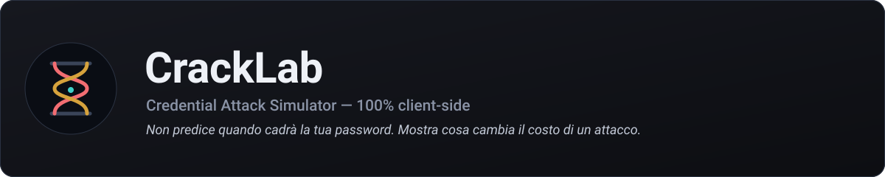

<p align="center"></p>

<p align="center"><a href="README.md">🇬🇧 English</a> · <a href="README.it.md">🇮🇹 Italiano</a></p>

<p align="center">
  
  
  
  
  
</p>

> It doesn't predict when your password will fall. It shows what really changes the cost of an attack.

<p align="center"><a href="SECURITY.md">Security</a> · <a href="docs/PRIVACY.md">Privacy</a> · <a href="docs/MODEL.md">Estimation model</a> · <a href="docs/THREAT_MODEL.md">Threat model</a> · <a href="ROADMAP.md">Roadmap</a> · <a href="LICENSE">Licence</a></p>

---

## 🇬🇧 English

## Overview

**CrackLab** is a bilingual, **100% client-side** educational simulator. It shows _how_ credential attacks
work and _how much_ modern defenses raise their cost — without being a cracker. Every number it shows is an
**order of magnitude** on **declared assumptions**, not a prediction.

The central lesson: **the site's storage algorithm multiplies the cost of every attempt, but a predictable
password stays predictable.** You need both — a password that can't be guessed _and_ correct server-side storage.

It is deliberately **not a cracker**: there is no input for third-party hashes, no wordlist cracking, and no
"break this hash" function. That is an architectural choice, and every attack scenario ends in a concrete defense.

## Features (MVP — "Prova")

- **Three preloaded examples** of different predictability, plus an invented sample you can type.
- **Local predictability estimate** with [zxcvbn-ts](https://zxcvbn-ts.github.io/zxcvbn/) (estimated guesses, 0–4 score).
- **Same password, four algorithms** — MD5 / SHA-256 / bcrypt / Argon2id — compared by order of magnitude of
  attack time and an illustrative cost, with the provenance of every figure (`measured` / `derived` / `assumption`).
- **A single concrete lesson and action** (password manager, generated passphrase, MFA).
- Bilingual **IT/EN**, full keyboard access, `prefers-reduced-motion`, and a permanent "use an example" warning — from day one.

See the [roadmap](ROADMAP.md) for the "Capisci" (guided scenarios) and "Progetta" (developer lab) phases.

## The estimation model

The model is the trust-critical, contestable core. For each _example × algorithm × scenario_:

```
estimated_guesses  = zxcvbn guesses (NOT 2^entropy, NOT the whole keyspace)
hash_rate          = benchmark per algorithm/params/hardware (data/benchmarks.json)
estimated_time     = estimated_guesses / hash_rate
estimated_cost     = (time in hours) × hourly_instance_price (data/pricing.json, illustrative, dated)
```

Three **declared scenarios** (prudent / central / aggressive) fix the hardware. Datasets are versioned and every
entry carries `source`, `date` and a `kind` of `measured`, `derived` or `assumption`; CI validates them and warns
when a benchmark is older than 12 months. See [docs/MODEL.md](docs/MODEL.md).

## Privacy, verified

The password never leaves the device — and this is **tested**, not just claimed:

- No network access while typing or computing (a Playwright [network-privacy test](e2e/network-privacy.spec.ts) asserts it).
- The input is never put in a URL, `localStorage`, a report or a share card. ESLint makes `fetch`, DOM-HTML sinks and
  browser storage a build error outside the one reviewed boundary (`src/store.ts`).
- Strict CSP and security headers (`vercel.json`), self-hosted assets, no third-party scripts or fonts.

See [docs/PRIVACY.md](docs/PRIVACY.md) and [docs/THREAT_MODEL.md](docs/THREAT_MODEL.md).

## Tech stack

| Area      | Choice                                             |
| --------- | -------------------------------------------------- |
| Language  | TypeScript                                         |
| UI        | React 19                                           |
| Build     | Vite 8                                             |
| Styling   | Tailwind CSS 4                                     |
| State     | Zustand (preferences only, allowlisted)            |
| Strength  | @zxcvbn-ts/core + IT/EN dictionaries (lazy-loaded) |
| KDF/hash  | hash-wasm + WebCrypto, in a Web Worker             |
| Animation | Motion                                             |
| Tests     | Vitest + fast-check, Playwright + axe              |
| Hosting   | Vercel                                             |

## Project structure

```
src/
├─ model/       pure estimation formulas + data/ (benchmarks.json, pricing.json) + tests
├─ strength/    zxcvbn-ts integration (predictability estimate)
├─ sim/         offline/online simulation engines (Fase 2)
├─ scenarios/   guided "Capisci" scenarios as data (Fase 2)
├─ components/  UI (StrengthMeter, …)
├─ i18n/        typed IT/EN catalogs
├─ store.ts     state — the only persistence boundary; the sample is never persisted
└─ App.tsx
```

## Getting started

Requires Node.js 22.12+ or 24.15+ (24 LTS recommended, see `.nvmrc`) and npm.

```bash
npm ci                # install the exact versions from package-lock.json
npm run dev           # start on loopback only: http://127.0.0.1:3000
npm run build         # production build
npm test              # unit tests (Vitest)
npm run test:coverage # tests + blocking coverage on model/ and sim/
npm run test:e2e      # Playwright suite (privacy, shell, axe) on the production build
npm run verify        # the full CI gate locally
```

Run `npx playwright install chromium` once before `npm run test:e2e`.

## Verifiable releases

Tagged releases follow Semantic Versioning and ship a deterministic archive with SHA-256 checksums and release
notes extracted from the changelog. See [CHANGELOG.md](CHANGELOG.md) and [docs/RELEASING.md](docs/RELEASING.md).

## License & terms of use

Released under the [GNU GPL-3.0 License](LICENSE). You may use, study, modify and redistribute the project while
preserving the copyright and licence notice.

## Estimate transparency

Expand **Parameters and sources** beside each algorithm to inspect KDF configuration, hardware, assumed rate, provenance, date and hourly pricing. Details follow the selected scenario. Formulas are explicit; current data are assumptions, not measurements or predictions. Local KDF benchmarking and online simulations remain planned.

## Comunità e collaborazione

- [Come contribuire](CONTRIBUTING.md)
- [Codice di condotta](CODE_OF_CONDUCT.md)
- [Segnalazioni di sicurezza](SECURITY.md)
- [Accessibilità e limiti delle verifiche](docs/ACCESSIBILITY.md)
- [Segnalare un problema o proporre un miglioramento](https://github.com/chiaraberti13/CRACKLAB/issues/new/choose)
- [Licenza del progetto](LICENSE)
